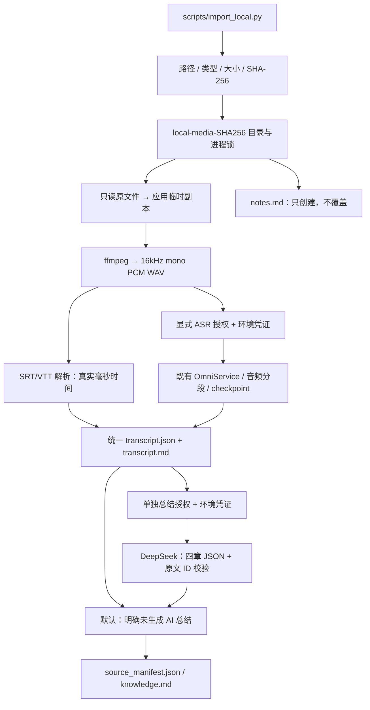

# Phase 1 — Local Media Import MVP

日期：2026-10-23（Asia/Tokyo）。仓库：`baigneuse/douyinmind`；分支：`feature/local-media-import`。

## 1. 交付结论与证据边界

已经实现可运行的本地音视频 CLI：MP4 / MP3 / M4A / WAV → 应用副本与 ffmpeg 规范化 → 真实 SRT/VTT 时间戳或显式启用的 Qwen Omni → 结构化逐字稿 → Markdown 导出。默认离线，不自动上传、不下载 ASR 模型、不启动浏览器、SQLite、Chroma 或前端。

本次实际完成 **120 秒公开 Sintel MP4 + 原发布 VTT** 的完整离线输入、五个产物导出、重复导入、原文件散列校验及人工笔记保留。22 条 caption 包含 13 条对白和 9 条环境声描述，来源为已有字幕，**不是 ASR 识别结果，也未验证字幕覆盖全部语音**。视频、字幕、逐字稿、用户笔记和处理缓存均留在 Git 忽略的本地目录。

**真实云端 ASR：BLOCKED。真实 AI 知识总结：BLOCKED / 未生成。** 用户没有提供本轮使用的服务凭证，也未授权真实媒体上传或付费调用。本次没有读取、使用现有真实密钥，没有发送任何模型请求。已实现显式开关和凭证检查，自动化验证使用明确标注的 Mock 或无网络子进程；这些不能替代真实模型验收。无总结时 `knowledge.md` 提供摘要、主题、关键论点、重要数字章节，但明确显示“未生成 AI 总结”，不把占位章节说成生成成功。

使用文档：[LOCAL_MEDIA_IMPORT.md](LOCAL_MEDIA_IMPORT.md)。可分享的脱敏验收记录：[PHASE1_ACCEPTANCE.md](PHASE1_ACCEPTANCE.md)。漏洞分类：[PHASE1_DEPENDENCY_AUDIT.md](PHASE1_DEPENDENCY_AUDIT.md)。

## 2. 基线、范围与兼容性

- 上游基准：`4f0bfbf5129cba45e8575562606df9aa04f7ed0b`。
- 开始实施前复用并提交 Phase 0 审计、离线 probe 及安装产生的 `backend/uv.lock`：`079abc7`（`docs: record Phase 0 audit and reproducible offline verification`）。随后建立当前功能分支。
- `origin` 是用户 Fork `baigneuse/douyinmind`；`upstream` 是 `MQTQW/douyinmind`。Phase 1 不合并 master，不向 upstream 提交。
- 保留现有 UI、路由、数据表、抖音采集与 RAG 默认行为。未新增数据库、embedding、平台采集器、桌面壳、完整框架或生产设施。
- 本地资产尚未显示在现有知识库 UI，也没有进入 SQLite / Chroma 检索。五个要求的文件和音频 checkpoint 使用既有 `backend/app/storage/` 目录，是当前 CLI 的处理产物，不是另建一套数据库或通用持久任务系统。
- Phase 0 的授权判断继续适用：README 声明 MIT，仓库仍缺独立 LICENSE。此次继续在 Fork 内改造，没有抽取代码另建产品；后续再分发前仍需澄清授权文本。

## 3. 实现与关键源码



| 文件 / 入口 | 本轮职责 |
| --- | --- |
| `backend/scripts/import_local.py::main` | argparse 薄入口；进度输出 stderr、完成 JSON 输出 stdout；exit 0 完成、1 处理错误、2 输入错误、3 BLOCKED、130 取消。导入应用前禁用 dotenv，仅允许对应显式开关启用的服务凭证。 |
| `backend/app/services/local_media_import.py::run_import` | 文件校验、2 GiB / 3 小时上限、SHA-256 身份、资产锁、输入输出重叠保护。 |
| 同文件 `_normalize` | 仅把原文件复制到应用临时目录后交给 ffmpeg；强制对应 demuxer，协议限 file/pipe；完整音轨转 16kHz 单声道 PCM16。原件始终只读。 |
| 同文件 `_run_locked` | 分阶段状态、配置指纹、产物散列、原子文件替换、逐字稿优先落盘、取消/失败恢复和源文件前后散列。 |
| 同文件 `_transcribe` / `_summary_chat` | 分别检查授权和凭证，显式配置模型、端点；本轮真实服务未调用。 |
| `backend/app/services/subtitle_import.py::parse_subtitles` | SRT/VTT、UTF-8/BOM 与 UTF-16 BOM、毫秒、重叠字幕、VTT cue 设置/注释、格式标签；拒绝空结果、无效范围、倒序或越界。不调用模型。 |
| `backend/app/services/local_markdown.py` | 完整原文 Markdown、稳定片段锚点、四章总结契约、证据类别、时间引用校验、长逐字稿分批覆盖、Markdown/HTML 转义。 |
| `backend/app/core/config.py` | 仅 CLI 显式设置 `DOUYINMIND_NO_DOTENV=1` 时禁用 dotenv；原 Web 启动继续原行为。 |
| `backend/app/services/audio_media.py::prepare_audio_segments` | 增加可选配置注入；默认仍使用原 settings。 |
| `backend/app/services/omni_service.py::OmniService` | 增加可选实例配置，复用原分段、返回结构和 checkpoint；默认现有调用不变。本地 CLI 禁用可选的边界补听请求。 |

未新增依赖。Qwen 路径复用现有 SDK 与 `VideoAnalysis.payload.transcript_segments`（秒）契约，入口统一转换为整数 `start_ms / end_ms`。没有伪造抖音 URL 或平台 ID；来源为 `source_type=local`、稳定 `local_<hash>` ID。

`source_manifest.json` 保存完整 SHA-256、原文件名（不写绝对源路径）、时长、大小、流水线版本、规范化版本、模型和端点、字幕散列、转写/总结配置指纹、阶段状态、输出散列、授权开关、原件完整性。不存在的成功阶段不会标成完成。

`transcript.md` 保留所有已导入片段，精确到毫秒；“完整”指保留所有输入字幕/模型返回片段，不保证字幕或 ASR 自身没有漏词。知识条目区分“原文陈述（未经外部核验）”“作者观点”“未经核实的外部事实”，每项必须引用当前输入片段。引用验证只能证明 ID 存在，不能证明语义支持充分或事实正确。

## 4. 缓存、失败与原件保护

同媒体内容落入同一个 `local-media-<完整 SHA256>` 目录；改名或移动输入不改变身份。规范音频与转写先校验产物散列再复用。转写指纹包含媒体/字幕散列、规范化/流水线/解析器版本，以及 Qwen 模型、端点、完整提示词散列、分段和固定 max_tokens。总结指纹包含逐字稿散列、模型/端点、提示词版本和总结实现文件散列。

逐字稿成功时立即原子写入并更新 manifest；总结失败或被阻断不会丢弃逐字稿。Qwen 部分识别复用既有音频 checkpoint；自动化覆盖是 Mock/既有 checkpoint 单测，**真实云端中断恢复尚未验收**。总结按批全成功才保存，不具备逐总结批次 checkpoint，重试可能重做已完成的总结批次。

审查中发现并修复两项恢复边界：

1. 成功后在重跑最初进度回调取消，会清空已完成缓存凭据。修复后同转写指纹保留完成凭据，重试不重复调用 ASR/总结。
2. 模型 A 总结完成，模型 B 首次失败后，旧总结可能被错误套上 B 指纹。修复为配置变化立即撤销旧总结完成凭据；回归验证 B 重试实际重新生成。

另将 Qwen max_tokens / timeout 显式设置，避免环境变量让真实调用配置偏离缓存指纹；Mock 总结即使使用真实字幕输入，也会明确标注测试替身。

`notes.md` 仅在缺失时使用独占创建模式，重跑、换模型、改字幕不覆盖；导出和缓存写入使用临时文件 + fsync + replace。锁防止同一媒体并发覆盖，OS 在进程结束后释放锁。正常失败/取消清理的是应用临时副本；保留规范音频与 checkpoint。强制杀进程可能留下应用临时副本，当前不提供自动缓存清理或保留策略；不会清理输入原件。

Ctrl-C 停止新识别任务，但已提交的服务请求不能撤回；既有并发执行器可能等待这些请求结束再保留 checkpoint。当前媒体提取为单个 ffmpeg 子进程，进度是阶段级，不是连续百分比。

## 5. 实际执行命令与测试

环境复用 Phase 0 已安装的 Python 3.12.14 / uv 环境和前端 node_modules；Node 24.13.1、npm 11.8.0、ffmpeg 7.1。本轮没有新增依赖、升级依赖或重新安装模型。全量测试已完成，原有断言和 skip 条件未修改。

新机器安装参考：

```powershell
cd backend
uv sync --python 3.12 --extra dev --frozen
# 安装 ffmpeg，并确保 ffmpeg 在 PATH
```

本机实际执行（路径仅用于复现本次 Windows 环境）：

```powershell
cd 'D:\新建文件夹\douyinmind\backend'
$env:PATH = 'D:\新建文件夹\.phase0-tools\bin;' + $env:PATH
.\.venv\Scripts\python.exe scripts/import_local.py --help
.\.venv\Scripts\python.exe scripts/import_local.py `
  --input 'app/storage/phase1_acceptance/公开媒体_日本語/Sintel_短片_日本語.mp4' `
  --subtitles 'app/storage/phase1_acceptance/公开媒体_日本語/Sintel_原字幕_日本語.vtt'

# 重复执行相同命令；人工备注及输入散列另以验收脚本比较
.\.venv\Scripts\python.exe -m pytest `
  --basetemp='D:/新建文件夹/phase1-evidence/pytest-full-final' -q -ra `
  --junitxml='D:/新建文件夹/phase1-evidence/backend-full.xml'

cd ../frontend
npm.cmd test
npm.cmd run build
npm.cmd audit --json
npm.cmd audit --omit=dev --json
```

每次 pytest 使用新的 `--basetemp`；不要重复使用正在保存证据的目录，因为 pytest 会清空该目录。Phase 0 已定位 Windows 默认临时目录权限问题，本轮沿用外部专用路径。

| 验证项 | 结果 |
| --- | --- |
| 后端最终全量 | **1014 passed / 0 failed / 0 errors / 1 skipped / 2 xfailed**，共 1017 项，100.81 秒；退出码 0 |
| 前端原测试 | **72 passed / 0 failed / 0 skipped**，10.86 秒 |
| 前端 TypeScript + Vite build | **PASS**；2212 modules，Vite 构建 14.87 秒 |
| 真实媒体 + 原发布 VTT CLI | **PASS**；120000 ms、22 caption、5 个文件、exit 0 |
| 真实媒体重复导入 / 人工笔记 / 原件散列 | **PASS**；transcript_reused=true，notes/输入字节散列保持 |
| 真实媒体云端 ASR 未授权阻断 | **PASS（阻断行为）**；exit 3，`cloud_asr_not_authorized`，不是 ASR 通过 |
| 真实 Qwen ASR / 真正 AI 总结 | **BLOCKED / 未运行**；无本轮凭证和调用授权 |
| npm audit | **8：6 high、2 moderate**；omit=dev 为 0；未修复或自动升级 |

新增测试分工：

- `test_subtitle_import.py`：54 项，真实字幕格式/时间解析的单元测试。
- `test_local_markdown.py`：38 项，完整导出、分批不丢文字、引用/事实类型/格式约束、Mock 标签。
- `test_local_media_import.py`：33 项，真实 ffmpeg 合成四格式媒体，中文/日文路径、空/坏输入、大小/时长、缓存、原件、notes、取消/恢复、模型/提示词变更。合成音调不是语音识别验收。
- `test_local_media_cli.py`：10 项，实际 CLI 子进程，网络调用封锁，合成非法 dotenv 不读取，退出码、五产物和笔记保护。
- `test_known_favorites_defects.py`：两个精确已知失败测试，见下一节；不计作通过。

通过数可核对为原有 **879** + 新增 **135**（54 + 38 + 33 + 10）= **1014**。唯一 skip 保持原测试 `tests/test_audio_boundary_independent.py:148`，原因 `Local frozen real experiment not present`；本轮没有补造这份真实实验数据或修改跳过条件。

过程记录：首轮新增字幕测试曾因指定临时目录的父目录不存在出现 **54 setup errors**；建立外部证据父目录并重新运行后为 54 passed，没有修改断言。新增本地导入测试先为 24 passed，再补覆盖至 28、30、33 项；最终单文件 33 passed。既有音频模块 + 新字幕/Markdown 的阶段回归曾为 162 passed。不要把分轮重复执行次数相加当成最终测试数。

本地日志与机器可读证据放在仓库外 `D:\新建文件夹\phase1-evidence\`：`backend-full.log/xml`、`frontend-test.log`、`frontend-build.log`、`real-media-import.log`、`real-media-repeat.log`、`real-media-acceptance.json`、`real-media-asr-blocked.log`、`public-media-provenance.json`、`known-defects-unmasked.log`。未把媒体、字幕、输出笔记或原始模型响应提交 Git。

提交前检查：`git diff --cached --check` 通过（初次发现两个新增文件的 EOF 空行，已移除）。19 个暂存文件仅包含源码、测试、说明和忽略规则，没有媒体、字幕、数据库或输出笔记路径。凭证模式扫描的一处命中经核对为 CLI 测试中明确用于拒绝测试的合成占位值，无未解决命中；扫描不构成全面安全审计。媒体、字幕、notes 和保留的测试临时目录均经 `git check-ignore` 确认被忽略。

## 6. 保留的既有缺陷与漏洞

两个 Phase 0 缺陷在本地导入路径之外，未扩大范围修复：

- FAV-001：同平台视频属于两个收藏夹时，`FavoriteVideo.platform_item_id` 唯一约束冲突。
- FAV-002：取消收藏导致删除 SQLite VideoCache 后，Chroma 孤儿块仍存在。

新增测试只针对精确观察到的症状使用 `xfail(strict=True, raises=KnownFavoritesDefect)`，其他异常正常失败；将来修复后会 XPASS(strict) 提醒更新测试。正常单独运行结果 **2 XFAIL**；加 `--runxfail` 后 **2 FAIL**，有意保留缺陷复现，不是把失败隐藏为通过。复现命令和证据见 [phase1-known-defects.md](phase1-known-defects.md)。**重新启用真实抖音批量同步前必须解决二者。**

npm 八包均位于开发/构建链，不能据此断言无风险：现有启动器运行 Vite dev server，Windows editor middleware 风险具有条件性可达路径；优先独立验证 Vite 6.x 补丁（公告修复门槛 6.4.4）。Tailwind 3 的传递链需要单独处理，npm 提议 Tailwind 4.3.3 涉及主版本迁移；braces 本次查询没有已发布补丁。当前没有改动前端锁文件，详细版本、公告及迁移风险在依赖审计中。

自动审批曾拒绝清理测试产生的 `.phase1-known-defect-tmp/`，仅返回 `blocked by policy`。未绕过该拒绝；目录已忽略且留在本地，后续测试迁至仓库外。它不是交付内容或待提交数据。

## 7. 外部依赖及未完成边界

本次真实使用：本地 Python/ffmpeg、公开 GitHub/MDN 教学素材及 Blender 许可页的 HTTPS 获取、npm 公告/registry 只读审计。没有抖音登录、Cookie、真实模型服务、embedding 或遥测上传。

已实现但未做真实服务验证：Qwen Omni 音频上传/结构化返回，DeepSeek 逐字稿总结。Qwen 缺凭证和权限时明确阻断；提供有效凭证后仍需在单独授权的短音频上核对模型可用性、时间戳质量、内容完整性、错误响应、费用和真实恢复。原识别服务含有限 SDK 重试及失败拆分重试，授权云调用并非一次请求的固定价格承诺。模型输出可能不准确，已有引用校验不代替人工核对。

其它限制：没有离线 ASR；只有媒体没有字幕且不启用云服务时无法自动生成语音文字；未做 3 小时 / 2 GiB 极限性能测试；总结分批失败会重做批次；没有字幕逐字编辑 UI、索引、跨视频问答或播放跳转 UI；首次成功后的配置切换会更新自动产物，当前不提供历史版本浏览，人工笔记始终保留。

## 8. 建议的下一阶段最小改动

建议继续在此 Fork 开发。现有 ffmpeg 分段、Qwen 契约和 checkpoint 已实际复用，原 UI/SQLite/Chroma/RAG 保留。此时抽取另建项目会引入授权澄清、配置和迁移成本，收益尚不足。

下一阶段只做现有 UI 的一个“导入本地文件”入口：

1. 复用 `run_import`，在现有 FastAPI 增加本地文件上传和任务状态接口。浏览器选文件后发送至本机服务的受管理暂存区，限制大小和类型；不要允许网页请求任意服务器路径。复用既有 worker，任务状态从 manifest 恢复。
2. 弹窗显示媒体、可选 SRT/VTT、离线/云端选项；离线为默认，云 ASR 与总结分别确认上传对象和可能费用。密钥由本地设置页管理，不能放在前端包或日志中。
3. 结果页显示来源、处理状态、毫秒时间戳、完整逐字稿、知识笔记与独立人工笔记；失败可重试。先完成预览/导出，继续不强制 embedding。
4. 如需让本地条目进入现有知识库，再对现有 SQLite 模型增加来源类型、内容散列及资产路径，沿用既有表/事务和索引服务，避免创建平行数据库。来源详情和跳转按类型分支，不再拼接抖音 URL；需要单独的数据迁移和 UI/API 回归。
5. 单独完成一段获授权短音频的真实 Qwen/总结验收；独立修复 Vite 及两项收藏夹缺陷后，才考虑发布或恢复真实批量同步。

不需要先做 Electron/Tauri、更多平台采集器或完整 Agent 框架。
